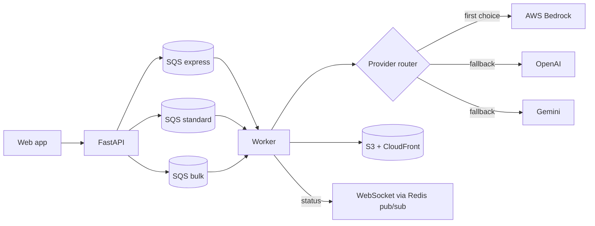

# ai-image-pipeline

Reference design and a small runnable core for a multi-provider AI image generation service on AWS. It is a generic rewrite of patterns I use in production, with no company code, data or credentials.

## Flow



## Design notes

- **Three priority queues.** Workers drain `express` first, then `standard`, then `bulk`, so a one-off request is never stuck behind a 500-image batch.
- **Provider router with fallback.** Providers sit behind one interface. If the first fails or times out, the next is tried, and the job records which one produced the image.
- **Same pipeline for every provider.** Prompt building, generation and QA scoring are separate stages, so adding a provider means implementing one method.
- **Delivery.** Images go to S3 and are served through CloudFront. Clients get progress over WebSocket, so the UI never polls.

## Layout

```
pipeline/
  providers.py   provider interface and the fallback router
  queues.py      priority-ordered job fetching
tests/           pytest, no network or AWS needed
```

## Run the tests

```bash
pip install pytest
pytest
```

To use real providers, implement `ImageProvider.generate` for Bedrock, OpenAI or Gemini and pass them to `Router` in the order you prefer.
